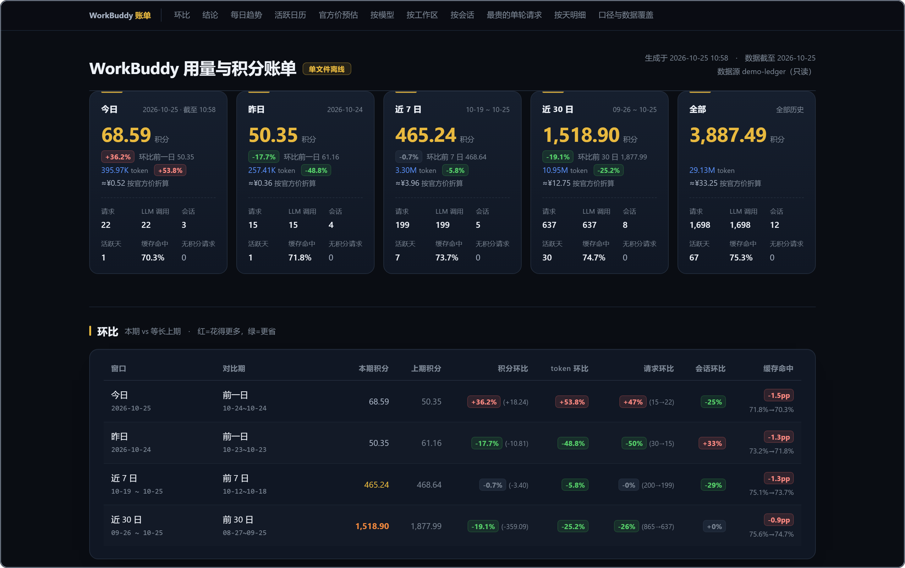
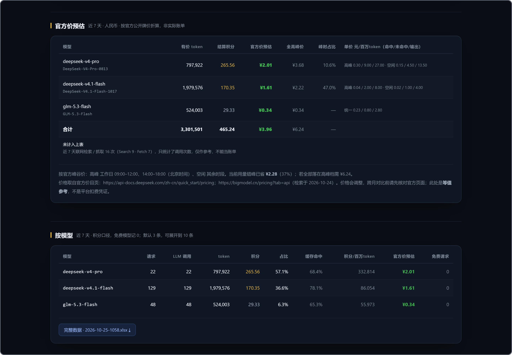
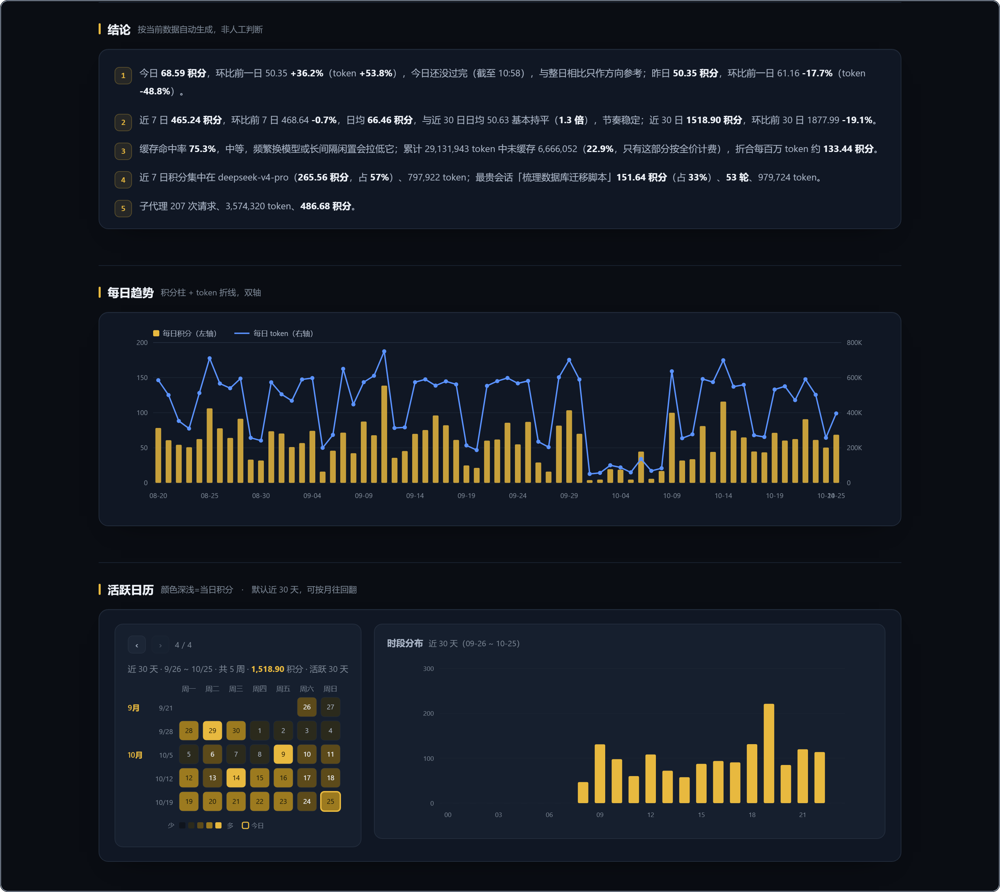

# wb-usage-report

把 WorkBuddy 的本机账本，摊成一张能归档的账单。

这是一个 [WorkBuddy](https://www.workbuddy.cn) 技能：纯 Python 标准库读取本机
`~/.workbuddy/` 下的用量记录，一次产出五档时间窗的 token / 积分报表，
带环比归因、按会话/模型/工作区下钻、人民币等值费用估算，输出一份可离线打开的单文件 HTML
和一个六 sheet 的 Excel 工作簿。

**只读、不联网、不上传、不调用任何大模型。** 日常出报表 0 积分 0 token。

```
今日 / 昨日 / 近 7 日 / 近 30 日 / 全部     ← 五档同屏，各带等长上期环比
        ↓
index.html（单文件，内联 SVG，断网可看）
<日期>-<时刻>.xlsx（汇总 / 逐请求 / 会话 / 模型 / 工作区 / 按天）
data.json（全量结构，供二次处理）
```



<sub>文中截图均由一份**合成账本**跑出来，数字全部虚构，不含任何人的真实用量。</sub>

## 为什么需要它

官方「套餐与用量」页面只有总量和逐条 Request，没有「按会话 / 按天 / 按模型 / 按工作区」
的多维拆解，也拿不到 token 与缓存命中的交叉视图。用久了会出现几个问题：

- 不知道**钱花在哪个会话**上——只能看到一条条请求，看不出主题；
- 不知道 **token 和积分为什么不成比例**——其实大部分输入是缓存命中，按折扣计价；
- 不知道**环比涨了是不是正常波动**——没有归因，一个百分比没有行动价值；
- 想把这些数字**换成 API 价格**看看值不值——账本里没有单价字段。

这个技能把这四件事一次做完，并且把每个数字的推导过程写在
[`references/data-model.md`](references/data-model.md) 里。

## 特性

| | |
|---|---|
| 五档时间窗 | 今日 / 昨日 / 近 7 日 / 近 30 日 / 全部，同屏并列，不用跑五次 |
| 环比 + 归因 | 积分、token、请求、会话四项变化率，自动归因到模型与会话 |
| 多维下钻 | 按模型、按工作区、按会话、按天、最贵的单轮请求 |
| 官方价预估 | 按官方人民币牌价折算，DeepSeek 峰谷价按**每条请求的时间戳**判定 |
| 单文件 HTML | 内联 SVG 图表、零外部引用、断网可看；导航 / 折叠 / 回顶全是内联 JS |
| 六 sheet Excel | 自带 OOXML 写入器，**不依赖 openpyxl**，任何 Python 3 直接跑 |
| 扫描缓存 | 按文件增量解析，热启动约 1.3s；缓存坏掉自动回退重算 |
| 上下文压缩 | 识别「经济模式」自动压缩，估算它省下的输入 token，单独一行交代 |
| 边界诚实 | 空窗口写「暂无」不写 `0`；上期覆盖不足会标注且**不拿它下判断** |

### 它顺便替你算了钱

账本里没有单价字段，只有积分。这个技能把积分按官方人民币牌价折成等值费用，
并且**按每条请求的时间戳**判断落在 DeepSeek 高峰还是空闲时段——同一份用量拆成
「折算价 / 全高峰价 / 峰时占比」三列，你能直接看出错峰省了多少。



## 快速开始

要求 **Python 3.8+**，无第三方依赖。

```bash
git clone https://github.com/<you>/wb-usage-report.git
cd wb-usage-report

# 只看终端摘要，不落盘
python scripts/report.py --format text

# 全量产物 + 自动打开
python scripts/report.py --format all --open
```

产物默认落在 `~/.workbuddy/usage-reports/<基准日>/`。

### 装成 WorkBuddy 技能

把整个目录放进 WorkBuddy 的用户级技能目录，重启后即可被识别：

```bash
# macOS / Linux
cp -r wb-usage-report ~/.workbuddy/skills/

# Windows PowerShell
Copy-Item -Recurse wb-usage-report "$env:USERPROFILE\.workbuddy\skills\"
```

装好之后，直接说「出一份用量报表」「看看昨天花了多少积分」「这个月 token 都花哪了」
就会触发它。`SKILL.md` 里写了完整的口径与硬规则。

### 定时任务（推荐用法）

每天 **00:05** 跑一次，出**前一天**的完整账单：

```
python ~/.workbuddy/skills/wb-usage-report/scripts/report.py --format all --anchor prev
```

为什么是 00:05：前一天 23:59 的请求此时已全部落盘，出的是完整自然日，
不会把当天半天数据混进来；白天再跑容易因为机器休眠错过触发。

## 命令参考

```bash
python scripts/report.py                            # 默认：截至基准日，全量产物
python scripts/report.py --format text              # 只在终端看摘要
python scripts/report.py --format html --open       # 只出网页并打开
python scripts/report.py --format xlsx              # 只出工作簿
python scripts/report.py --format json              # 纯 JSON 到 stdout
python scripts/report.py --days 7 --open            # 聚焦最近 7 天（整份重算，不只裁明细）
python scripts/report.py --anchor 2026-10-15        # 回溯某天的快照
python scripts/report.py --anchor prev              # 强制前一天
python scripts/report.py --no-cost                  # 不算费用，只看 token 与积分
python scripts/report.py --no-cache                 # 忽略缓存，全量重扫
python scripts/report.py --config-dir /path/to/.workbuddy   # 指定账本目录
python scripts/report.py --out ~/reports/bill       # 指定输出目录
```

| `--anchor` | 含义 |
|---|---|
| `auto`（默认） | 本地时间 06:00 前退到前一天，之后取当天 |
| `prev` | 强制前一天（定时任务用这个，最确定） |
| `today` | 强制当天 |
| `2026-10-20` | 回溯某个历史日 |

## 数据源

全部只读，均在 `~/.workbuddy/` 下：

| 路径 | 取什么 |
|---|---|
| `workbuddy.db` | `session_usage.credit_json`（积分结算）、`sessions`（标题 / 上下文占用） |
| `projects/**/*.jsonl` | `providerData.rawUsage`（token）、`model`、`cwd`、时间戳 |
| `projects/**/subagents/*.jsonl` | 子代理日志，`requestId` 与主日志无交集，可安全并入 |

缺 `workbuddy.db` 时降级为「仅 token 口径」；缺 `projects/` 时降级为「仅积分口径」，
两种情况都会在报表里写明，不会静默出个半成品。

写操作只有一处：缓存落在自己的产物目录 `~/.workbuddy/usage-reports/.cache/`，
**账本本身一个字节都不会被写**。

## 隐私

- **不出网。** 没有任何 HTTP 请求，价目表是硬编码在 `scripts/pricing.py` 里的常量。
- **不上传。** 没有遥测、没有统计、没有 crash report。
- **不读凭据。** 只解析上面三个路径下的日志与 SQLite。
- **产物只在本机。** 报表里含会话标题与工作目录，分享前请自行判断是否脱敏——
  这个仓库本身不含任何人的报表。

## 口径与已知局限

完整推导见 [`references/data-model.md`](references/data-model.md)。要点：

- **token 是累计处理量，求和而非取最大值。** 同一 `requestId` 下的多行是多次独立
  LLM 调用（工具调用循环里上下文逐次增长），不是重复写入。
- **积分取平台结算值**，缺失时用 `rawUsage.credit` 末次值补齐，两者**不相加**。
- **「今日」恒指系统当天**，与基准日无关——否则 `--anchor prev` 会把这张卡改名成
  「昨日」，用户再也看不到今天花了多少。
- **空窗口写「暂无」而不是 `0.00 积分`**，环比写「本期暂无数据」而不是 `-100%`。
- **上期覆盖不足会标注且不参与判断。** 上期左边界早于本机最早记录日时，环比会虚高到
  几百上千个百分点，那是假象。
- **不做任何外推补偿。** 少数超长会话的 token 会偏低 3–8 倍（中间调用没有逐行落盘），
  按比例放大能凑出更像样的数字，但不可复现，所以宁可偏低并写明。

### 上下文压缩是怎么计费的

「经济模式」会在上下文接近上限时自动压缩历史，把旧消息换成摘要。它**不是免费操作**：
压缩那一次本身就是一次普通模型调用，按同样的单价计费，这部分消耗已经算在 token 与
积分总量里，报表不额外补、也不扣。

真正需要交代的是**它省了多少**。日志里没有压缩事件——`type` 全集里根本没有这一种——
唯一的痕迹是同一个请求内 `prompt_tokens` 的**突然回落**。报表按「比上一轮跌 15% 以上」
识别压缩（正常轮次只增不减），并把

```
省下的输入 token ≈ 回落幅度 × 该请求在压缩之后的剩余调用次数
```

当作节省量。三点必须说清：

1. 这是**毛估算且偏保守**——被砍掉的上下文在真实情况下还会继续增长；
2. 省下的是**输入 token**，其中大部分本会命中缓存（按折扣计价），
   所以这个数**不能等同于积分节省**；
3. 压缩本身那一次的消耗已含在总量里，不从这个数里扣。

报表把「近 7 日」「全部」两档的压缩次数与节省量放在 KPI 卡片下方的一行里；
一次都没触发时整行不出现——短会话撞不到上下文天花板，印一行「0 次」只是噪声。

### 零点刚过时，今日那一档为什么不给环比

刚过零点，今日可能只累积了几十分钟、个位数积分。拿它去跟整整一个昨日比，必然
得出 **-99% 量级**的环比——看起来像用量塌陷，实际只是还没开工。所以报表会在
两种情况下把「今日 vs 前一日」这个**比较整体收起来**：

- 本地时间在 **00:30 之前**（这个点开报表，本来就是为了看昨天的完整账单）；
- 今日积分**不足 5**（样本太薄；5 积分在典型使用强度下约合 3M token、1~4 个请求）。

> 为什么用积分而不是请求数当样本量：请求的粒度差异太大，一句短问答和一次长任务
> 能差两个数量级；积分是跨模型唯一可比的量。

被降级时，今日卡的环比位置写「起步中 · 样本不足，不算环比」，环比表今日行全留
「—」，结论区不再出「今日 X 积分，环比 -95%」这一句——但**数字照给**，积分、token、
请求数一个不少。

这道闸门只影响**展示**，不改任何窗口的数值：近 7 日 / 近 30 日 / 全部里今日的用量
照旧算在内，账对得上。想强制看环比，加 `--today-gate off`。

### 删掉会话会让积分偏低

删除一个会话时，`session_usage` 里对应的结算行会跟着消失，但
`projects/**/*.jsonl` 的日志还在磁盘上。结果是这些请求**token 照算、积分算 0**。

这个偏差**只有一个方向：积分只少不多**，不会虚高。报表的「口径与数据覆盖」会把
已删会话的数量、它们的 token，以及其中「有 token 但没有积分结算」的部分单独列出来，
方便你判断差额是不是这个原因造成的。

### 0 积分不等于永久免费

模型处于**限免期**时，平台的结算值与日志末次值都给 0，报表据此标「免费」。这只
说明**当下不收费**，不代表它永远免费——限免结束的当天，同一个模型会从 0 直接跳到
上百上千积分。

所以看到某个模型「几十 M token 但 0 积分」，先确认它是不是还在限免期内，再怀疑
统计漏账。同一个模型在同一天里既带「免费」标记又有实际积分也正常：那是限免刚结束，
两边都发生在当天。

> **口径声明：token 与积分均为参考值，不等同于官方账单，不作为扣费争议依据。**
> 费用预估是按官方牌价折算的等值参考，不是平台实际扣费。

## 报表长什么样

结论区不堆数字，而是自动写成几句话：今天比昨天涨了多少、是不是 7 日日均的两倍、
钱集中在哪个模型和会话上。下面的趋势图与活跃日历用来**定位异常发生在哪一天、哪个时段**——
日历按月分页，默认停在最近 30 天，行数随月份周数变化。



`--days 7` 这类聚焦模式会把 KPI、环比与维度表一起收窄，不是只裁明细。

## 目录结构

```
wb-usage-report/
├── SKILL.md                 # 技能定义：WorkBuddy 读这个文件决定何时触发、怎么用
├── README.md                # 本文件
├── CHANGELOG.md
├── LICENSE
├── scripts/
│   ├── report.py            # CLI 入口：参数解析、编排、落盘
│   ├── collect.py           # 读 SQLite + jsonl，含按文件增量缓存
│   ├── aggregate.py         # 五档窗口、环比、归因、结论、维度聚合
│   ├── pricing.py           # 价目表 + 峰谷判定 + 内置法定节假日
│   ├── render.py            # HTML 渲染（CSS / 内联 SVG / 折叠脚本）
│   └── xlsx.py              # 极简 OOXML 写入器，多 sheet + 居中 + 冻结首行
├── references/
│   └── data-model.md        # 每个数字怎么算出来的，以及为什么排除其他算法
├── assets/                  # README 截图（合成账本产物；不进任何分发包）
├── tools/
│   └── build.py             # 一次打出完整包与精简包
└── tests/
    └── smoke.py             # 自检：模块导入、CLI 接口、xlsx 结构、发布字段
```

## 自检

```bash
python tests/smoke.py
```

检查解释器版本、五个库模块能否导入、CLI 参数是否齐全、`xlsx.py` 产出的包是否是
合法 OOXML、`SKILL.md` 的 frontmatter 字段是否齐全且中英条数一致、README 里的图片
链接与 `assets/` 是否双向对齐（不引用不存在的图，也不留没被引用的死图）。
本机有账本时会额外跑一次真实出表并校验内嵌工作簿。

改完 SKILL.md 或脚本后重新打包：

```bash
python tools/build.py
```

在仓库上一级目录产出两个 zip（完整包 / 精简包），并打印各自的大小、文件数、
md5 与 zip 完整性校验结果。**两个包都不含 `assets/`**——截图只服务于本页的说明。

## 兼容性

- Python **3.8+**，Windows / macOS / Linux
- `--open` 在 Windows 用 `os.startfile`，macOS 用 `open`，Linux 用 `xdg-open`
- Windows 控制台若中文乱码：`set PYTHONIOENCODING=utf-8`
- 价目表会随官方调价失效，改 `scripts/pricing.py` 顶部的 `RATE_CARDS` 一处即可

## 许可

[MIT](LICENSE)
